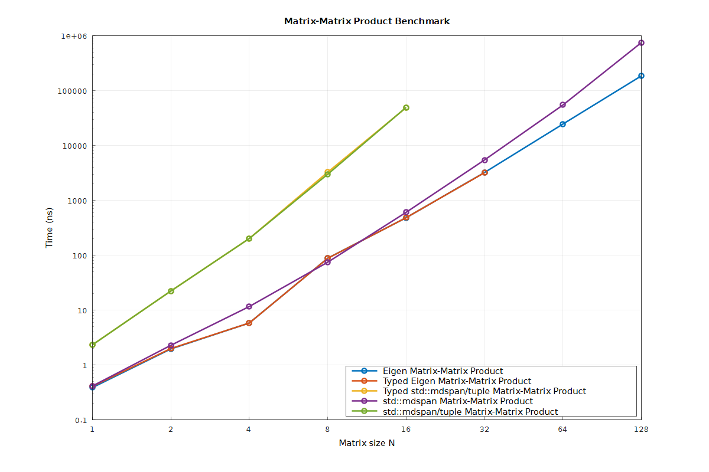

# Benchmarks

Build and run the benchmarks on Windows platform:

```shell
git clone --depth 1 "https://github.com/FrancoisCarouge/TypedLinearAlgebra" "linalg"
Remove-Item -Path build -Force -Recurse
cmake -S "linalg" -B "build" -G "Visual Studio 18 2026" -DBUILD_BENCHMARKING=ON
cmake --build "build" --config "Release" --parallel 1
ctest --test-dir "build" --build-config "Release" --tests-regex "bench" --parallel 1
```

# Results

Disclaimer: naive benchmark results for illustration purposes only.

MSVC 19.50.35728.0



| Title | Size | Median Elapsed Time (ns) | Median Absolute Percentage Error (%) |
| --- | --- | --- | --- |
| Eigen::Matrix | 1x1 | 0.39 | 0.54 |
| Eigen::Matrix | 2x2 | 2.14 | 0.11 |
| Eigen::Matrix | 4x4 | 5.81 | 0.21 |
| Eigen::Matrix | 8x8 | 88.22 | 0.64 |
| Eigen::Matrix | 16x16 | 481.61 | 0.55 |
| Eigen::Matrix | 32x32 | 3206.42 | 0.31 |
| Eigen::Matrix | 64x64 | 24504.08 | 0.12 |
| Eigen::Matrix | 128x128 | 186740.00 | 0.53 |
| typed matrix from Eigen::Matrix | 1x1 | 0.58 | 0.23 |
| typed matrix from Eigen::Matrix | 2x2 | 1.96 | 0.76 |
| typed matrix from Eigen::Matrix | 4x4 | 5.82 | 0.35 |
| typed matrix from Eigen::Matrix | 8x8 | 87.91 | 0.38 |
| typed matrix from Eigen::Matrix | 16x16 | 481.80 | 0.68 |
| typed matrix from Eigen::Matrix | 32x32 | 3184.02 | 0.46 |
| std::mdspan | 1x1 | 0.39 | 1.46 |
| std::mdspan | 2x2 | 2.17 | 0.85 |
| std::mdspan | 4x4 | 11.72 | 0.63 |
| std::mdspan | 8x8 | 74.62 | 0.25 |
| std::mdspan | 16x16 | 603.75 | 0.38 |
| std::mdspan | 32x32 | 5432.71 | 0.25 |
| std::mdspan | 64x64 | 54589.47 | 0.25 |
| std::mdspan | 128x128 | 706700.00 | 0.69 |
| typed matrix from std::mdspan | 1x1 | 0.40 | 4.15 |
| typed matrix from std::mdspan | 2x2 | 2.18 | 0.85 |
| typed matrix from std::mdspan | 4x4 | 11.96 | 0.58 |
| typed matrix from std::mdspan | 8x8 | 74.93 | 0.28 |
| typed matrix from std::mdspan | 16x16 | 603.71 | 0.26 |
| typed matrix from std::mdspan | 32x32 | 5466.13 | 0.49 |
| std::mdspan from std::tuple | 1x1 | 2.33 | 0.46 |
| std::mdspan from std::tuple | 2x2 | 22.23 | 0.13 |
| std::mdspan from std::tuple | 4x4 | 201.26 | 0.11 |
| std::mdspan from std::tuple | 8x8 | 2941.67 | 0.75 |
| std::mdspan from std::tuple | 16x16 | 49240.91 | 0.25 |
| typed matrix from std::mdspan from std::tuple | 1x1 | 2.34 | 0.74 |
| typed matrix from std::mdspan from std::tuple | 2x2 | 22.27 | 0.29 |
| typed matrix from std::mdspan from std::tuple | 4x4 | 201.59 | 0.38 |
| typed matrix from std::mdspan from std::tuple | 8x8 | 3235.77 | 0.52 |
| typed matrix from std::mdspan from std::tuple | 16x16 | 48885.71 | 0.25 |
